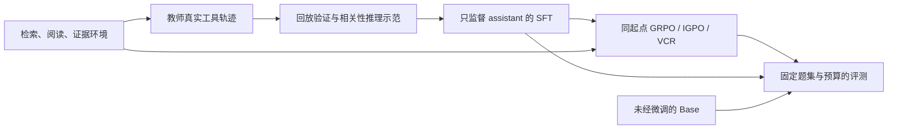

# EviSearch-RL

**让小模型在多跳问答中学会检索、阅读、保存证据，并检查自己对证据的判断。**

模型不仅要答对，还要指出答案来自哪些已经读过、保存过的原文。项目使用 Qwen3.5-2B、LoRA SFT 和真实工具交互下的强化学习，研究终局奖励与可验证声明奖励（VCR）分别改变了什么。

当前仓库只有一套实现。GRPO、IGPO、VCR 是这套实现里的对照算法，共用数据、环境与评测协议。过去的试验如何推动当前设计，集中写在[演化故事](docs/evolution.md)，不需要先阅读旧版代码。

## 从哪里开始

| 想解决的问题 | 阅读入口 |
|---|---|
| 先看一次完整交互 | `python -m evisearch.demo`：无需模型、语料或 GPU 的合成示例 |
| 从零理解当前代码 | [六课教学路线](docs/learning/README.md)：一课一个机制，直接阅读当前源码 |
| 为什么最终采用这套方法 | [完整演化故事](docs/evolution.md)：v1–v5 的实验数字、失败诊断、判断反转、数据与成本，以及当前结论边界 |
| 运行训练与评测 | [复现说明](docs/reproduction.md)：环境、冻结产物、命令与边界 |
| 判断结果说明了什么 | [当前结果](results/README.md)、[机器可读摘要](results/current.json) |

## 一条主线



每题使用 MuSiQue 的本地候选文档，以 BM25 排序。模型最多执行 **3 次 search、8 次 read、8 次 add_evidence**，最终返回 `{"answer":"...","evidence_ids":["..."]}`。`search` 只发现候选，`read` 打开原文，`add_evidence` 保存已读片段；最终引用必须指向已保存证据。

SFT 数据共 6,000 条混合示范，其中 1,800 条 Agent 示范由真实教师交互、筛选和回放构建；通用 Agent 示范再加入相关性判断。RL 使用独立的 1,024 题，每题 4 条轨迹、每组两次更新，共 2,048 次更新。SFT 的样本占比与监督 token 占比分开统计。

终局奖励是训练口径的答案 token-set F1 × 证据 F1。截断、非法调用、格式错误、非法或重复引用得到 −2。VCR 另外核验模型写出的“这篇文档回答第几跳、得到什么答案”，把正确或错误声明形成的轮次信号加入 GRPO 优势。金标分解只用于训练监督和离线审计，不放入评测时的模型提示。

## 当前证据

同一相关性推理 SFT 起点，test 512 题、greedy、相同工具和生成预算，单训练种子：

| 方法 | EM | 答案 F1 | 证据完整率 | 提前停止率 ↓ |
|---|---:|---:|---:|---:|
| GRPO | 56.25% | **66.66%** | 64.26% | 28.12% |
| IGPO | 52.54% | 61.14% | 62.30% | 27.15% |
| VCR | **56.84%** | 65.13% | **67.19%** | **17.19%** |

VCR 相对 GRPO 的 EM 差为 +0.59 个百分点，95% 配对区间 [−2.93, +4.30]，**不能据此宣称答案准确率稳定提升**。更明确的观测是提前停止率下降 10.94 个百分点，区间 [−14.65, −7.23]。F1 反而低于 GRPO。

未经微调的 Base 与原教师示范 SFT，在同一 Agent 协议上的 test EM 为 6.25% / 43.75%，格式合规率为 12.30% / 100%；收到完全相同静态检索材料时，EM 为 13.67% / 18.95%。因此，SFT 的协议、工具控制收益不能直接当作纯推理能力提升。相关性推理 SFT 起点尚缺单独的完整 test 评测，不能用原 SFT 替代它做 RL 净增益归因。

这些是整理前已完成实验的记录，已从预测产物重算；不是目录整理后重新训练所得。test 在长期研究中被多次查看，不能称为全新盲测。区间不包含训练种子不确定性。[详细口径与限制](results/README.md)。

## 按职责找代码

```text
evisearch/
  environment.py          三个工具、状态、预算、引用验证
  retrieval.py            BM25 与通用评分函数
  model.py                分词器、LoRA、checkpoint 恢复
  data/                   教师采集、轨迹回放、补救与相关性示范
  training/               GRPO/IGPO 优势、训练器、VCR 声明核验
  evaluation/             greedy rollout、完整任务集配对比较、行为审计
  sft.py                  SFT 入口
  train.py                共用 SFT 起点的三个 RL 入口
  evaluate.py             统一评测入口
  artifacts.py            冻结外部产物位置与新运行目录
  demo.py                 无 GPU 的最小教学例子
configs/                   固定训练配方与 LoRA 配置
docs/learning/             当前实现的六课教程
docs/evolution.md          唯一演化故事
results/                   当前结果与可核对的摘要
resources.py               GPU 准入、显存余量、运行锁
check_*.py                 CPU 契约与恢复检查
report.py                  从真实预测重算当前结果
```

## 先跑一个例子

```bash
python -m evisearch.demo
```

示例只用 Python 标准库、合成文档和确定性动作，展示证据如何进入最终答案；它不代表模型学会了这些动作。

本机完整检查使用已有专用环境：

```bash
/data3/dzh/MedSearchRL/venv/bin/python check_data.py
/data3/dzh/MedSearchRL/venv/bin/python check_resume.py
/data3/dzh/MedSearchRL/venv/bin/python check_release.py
/data3/dzh/MedSearchRL/venv/bin/python report.py
```

模型、数据、缓存、日志与 checkpoint 均在仓库外。**Git clone 本身不包含冻结训练数据和权重**；完整运行的前置产物见[复现说明](docs/reproduction.md)。新产物写入独立的 `runs/release`，不会覆盖已有实验。

教学组织参考 [learn-claude-code](https://github.com/shareAI-lab/learn-claude-code) 的“一课一个机制”；按职责组织代码与研究叙事参考 [Shopping GRPO 的 main 分支](https://github.com/YYHDBL/shopping-grpo-longhorizon/tree/main)和[配套故事](https://yyhdbl.github.io/)。借鉴的是表达方式，实验与结论来自本项目。
