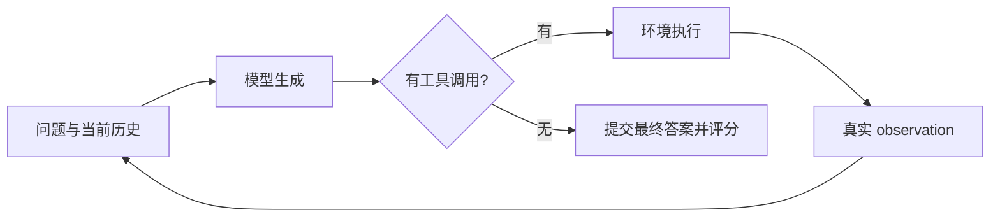

# 01：先跟着一个问题走完

问题：**Journal Z 的拥有者成立于哪一年？**

这不是在一篇文章里直接找年份。需要先得到“Journal Z 由 Example University 拥有”，再得到“Example University 成立于 1960 年”。只有第二篇文档，无法证明该学校与问题有关；只有第一篇，无法回答年份。

## 运行一个最小例子

在仓库根目录执行：

```bash
python -m evisearch.demo
```

例子会发现三篇文档，阅读并保存两个支持片段，输出包含 `1960` 和两个 `evidence_ids` 的 JSON，再演示正确与错误来源声明的验证。它使用合成数据和确定性动作，**不是 LLM rollout，也不能作为模型成绩**。

## 真正的模型循环在哪里

打开 [evaluation/rollout.py](../../evisearch/evaluation/rollout.py) 的 `episode()`：

1. 建立 `EvidenceEnv`，从问题构造不含答案、支持 ID 或分解标签的提示。
2. 模型生成一轮输出，`parse_response()` 将原生工具格式解析为结构化调用。
3. 有调用时，环境执行动作，将真实 observation 放回消息历史。
4. 没有调用时，尝试提交最终 JSON；结束后统一算答案与证据指标。



训练阶段不使用这个手写 greedy evaluator 代替采样。训练器继承 TRL 的原生工具循环，环境把相同的三个工具暴露给 TRL；greedy evaluator 用于冻结协议下的独立评测。

## 模型看到什么，评分器看到什么

模型看到问题、工具说明及自己操作获得的文档内容。环境内部保存金标，方便评分，但 [environment.py](../../evisearch/environment.py) 的 `task_prompt()` 不会把这些字段传给模型。

这是一条重要边界：评分器知道答案，不代表 actor 可以看到答案。第 3 课会介绍训练数据构建时另有特权监督，并解释它如何在最终示范提示中去除。

## 自检

- 如果只返回字符串 `1960`，为什么不算一次合规的证据 Agent 输出？
- 如果模型生成一个工具标签，但没人执行它，能否证明它具备工具能力？
- 为什么合成示例跑通只能验证机制，不能证明模型效果？

答案分别是：协议要求答案与合法引用；工具能力必须包含真实执行与观察反馈；示例动作由代码预先指定，模型没有参与决策。

下一课：[工具与证据](02-evidence.md)。
